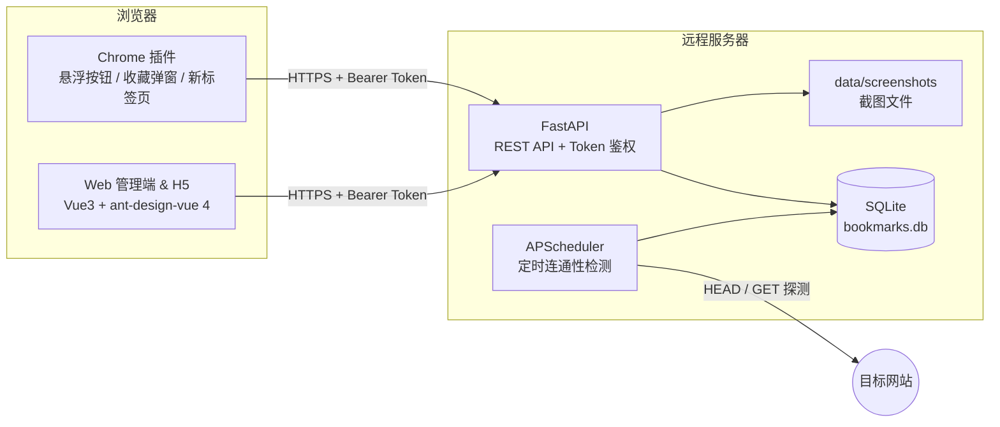
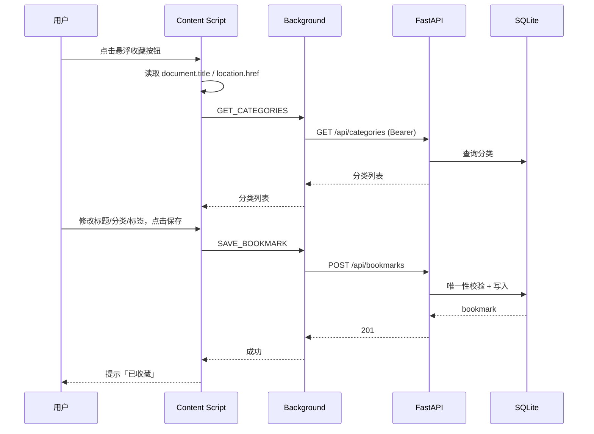
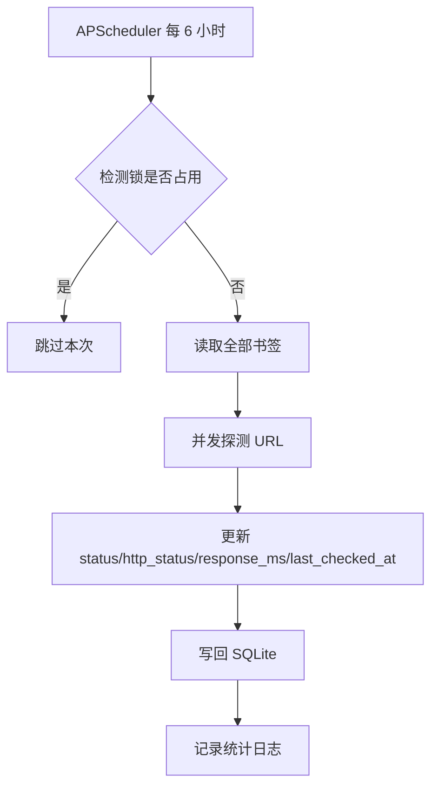

# 网络书签系统 开发文档

> 项目代号：Bookmark Hub  
> 文档版本：v1.1（P0–P8 + 批量删除 + 访问统计 + Token 设置）  
> 最后更新：2026-10-22  
> 技术路线：FastAPI + SQLite + Chrome Extension + Vue 3 / ant-design-vue 4.x / Vite 8.2

---

## 修订记录

| 版本 | 日期 | 说明 |
|---|---|---|
| v0.1 | 2026-10-22 | 初版技术选型与开发计划 |
| v0.2 | 2026-10-22 | 补充导入导出、标签聚合、摘要/截图、新标签页；确认 ant-design-vue 4.x + Vite 8.2 |
| v1.0 | 2026-10-22 | 按 P0–P8 完成前后端与插件实现，补充实现差异与运行说明 |
| v1.1 | 2026-10-22 | 书签列表支持多选批量删除、访问统计；新增批量删除、访问记录、Token 设置接口 |

## 实现状态（v1.1）

| 阶段 | 内容 | 状态 |
|---|---|---|
| P0 | 工程初始化、目录、依赖、配置 | ✅ 完成 |
| P1 | 数据库模型、Token 生成、鉴权、统一响应 | ✅ 完成 |
| P2 | 书签/分类/标签 CRUD、分页搜索筛选 | ✅ 完成 |
| P3 | 连通性检测、定时任务、手动复检 | ✅ 完成 |
| P4 | 导入导出、统计接口 | ✅ 完成 |
| P5 | Web 管理端（ant-design-vue 4.x + Vite 8.2） | ✅ 完成 |
| P6 | H5 页面、插件新标签页 | ✅ 完成 |
| P7 | Chrome 插件（配置、悬浮按钮、弹窗、新标签页） | ✅ 完成 |
| P8 | pytest、systemd/Nginx/备份、README | ✅ 完成 |
| v1.1 | 书签列表多选批量删除、访问统计、Token 设置 | ✅ 完成 |
| v1.2 | 网页摘要、封面、截图 | ⏳ 数据表字段已预留，接口未实现 |

**实现与本文档的少量差异：**

1. 插件的按钮与弹窗样式内嵌在 `content.js` 的 Shadow DOM 中，没有单独的 `content.css`，避免页面样式与 CSP 干扰；
2. H5 页面支持 `#/h5?token=xxx&q=关键词`，新标签页搜索会携带 `q` 直接打开 H5；
3. 导入接口同时支持 `multipart/form-data`（上传文件）和 `application/json`（请求体），与 5.9 节一致；
4. 前端使用 hash 路由；Token 在桌面端存 `localStorage`，H5 存 `sessionStorage`；
5. 插件所有网络请求经 background 代理，规避混合内容与 CORS 限制。

**运行方式：** 见根目录 [`README.md`](../README.md)。测试命令 `cd backend && .venv/bin/python -m pytest -q`，当前 14 个用例全部通过；前端 `npm run build` 与 `vue-tsc --noEmit` 均通过。

---

## 目录

1. [项目概述](#1-项目概述)
2. [功能需求](#2-功能需求)
3. [技术选型与总体架构](#3-技术选型与总体架构)
4. [数据库设计](#4-数据库设计)
5. [API 接口设计](#5-api-接口设计)
6. [后端实现方案（FastAPI + SQLite）](#6-后端实现方案fastapi--sqlite)
7. [Web 前端设计（ant-design-vue 4.x + Vite 8.2）](#7-web-前端设计ant-design-vue-4x--vite-82)
8. [Chrome 插件设计](#8-chrome-插件设计)
9. [关键业务流程](#9-关键业务流程)
10. [开发计划与里程碑](#10-开发计划与里程碑)
11. [测试计划](#11-测试计划)
12. [部署与运维](#12-部署与运维)
13. [风险与应对](#13-风险与应对)
14. [后续扩展路线](#14-后续扩展路线)
15. [附录](#15-附录)

---

## 1. 项目概述

### 1.1 背景

浏览网页时经常遇到值得收藏的内容，但浏览器本地书签存在三个问题：

- 换电脑、换浏览器后书签不同步；
- 收藏后长期不访问，链接失效却无从得知；
- 书签散落在文件夹里，缺少分类、标签和搜索能力。

本项目做一个 **自托管的网络书签系统**：

- 通过 Chrome 插件在任意网页上一键收藏；
- 数据保存在自己的远程服务器（SQLite 单文件）；
- 任何一台临时电脑，用浏览器打开远程地址 + Token 即可管理收藏夹；
- 服务端定期探测每个收藏 URL 的连通性，异常链接自动打标。

### 1.2 目标

| 目标 | 说明 |
|---|---|
| 收藏快 | 网页上点按钮 → 弹窗 → 保存，3 秒内完成 |
| 数据自主 | 数据完全存放在自己的服务器，不依赖第三方服务 |
| 随处可用 | 有浏览器 + Token 即可访问，无需安装插件 |
| 可维护 | 异常链接自动标记，定期巡检 |
| 易部署 | 单机、单进程、单 SQLite 文件，一条命令启动 |

### 1.3 术语表

| 术语 | 含义 |
|---|---|
| Bookmark | 一条书签记录，包含 URL、标题、分类、标签等 |
| Category | 分类，一本书签最多属于一个分类，可为空 |
| Tag | 标签，一本书签可以有多个，用于聚合与交叉检索 |
| API_TOKEN | 服务端启动时生成的高熵令牌，所有写操作必须携带 |
| 连通性检测 | 服务端定期对书签 URL 发起 HTTP 请求，记录状态 |
| 异常 | 检测结果为 `error` 或 `timeout` 的书签 |
| H5 端 | 面向临时电脑/手机的轻量 Web 页面，Token 访问 |
| 新标签页 | 插件接管浏览器新标签页，展示最近书签 |

---

## 2. 功能需求

### 2.1 用户角色

系统为**单用户自托管**设计，只有一个角色：持有 API_TOKEN 的用户。  
所有管理能力（增删改查、导入导出）均要求 Token；不设注册、登录、多租户（后续可扩展）。

### 2.2 核心功能（MVP，v1.0）

| 编号 | 功能 | 说明 | 优先级 |
|---|---|---|---|
| FR-01 | 插件配置 | 设置服务器地址、API Token，本地保存 | P0 |
| FR-02 | 网页收藏按钮 | 打开网页时注入悬浮按钮（可在设置中关闭） | P0 |
| FR-03 | 收藏对话框 | 展示当前 URL、自动填充网页 title，可修改；选择分类、填写标签；保存 | P0 |
| FR-04 | Token 鉴权 | 所有 API 请求校验 `Authorization: Bearer <token>` | P0 |
| FR-05 | 书签 CRUD | 新增、列表、详情、编辑、删除 | P0 |
| FR-06 | 分类管理 | 分类的增删改查；删除分类后书签分类置空 | P0 |
| FR-07 | 列表检索 | 关键字搜索（标题/URL）、按分类筛选、分页、排序 | P0 |
| FR-08 | 连通性检测 | 定时全量探测 + 单条手动复检；异常链接标记 `异常` | P0 |
| FR-09 | Web 管理端 | 浏览器打开远程地址，输入 Token 后管理书签 | P0 |
| FR-10 | H5 临时访问 | `http://server/#/h5?token=xxx` 直接查看、编辑、删除 | P0 |
| FR-11 | 导入 / 导出 | 支持 JSON、Netscape HTML 书签文件互导 | P1 |
| FR-12 | 标签聚合 | 标签云展示每个标签的书签数，点击即筛选 | P1 |
| FR-13 | 新标签页 | 插件接管新标签页，展示最近收藏 + 快捷搜索 | P1 |
| FR-14 | 统计概览 | 总数、正常、异常、超时、未检测数量 | P2 |
| FR-15 | 网页摘要 | 保存时抓取 `<meta description>` / `og:image` 作为摘要和封面 | P2 |
| FR-16 | 网页截图 | 插件截取当前可视区域，随书签上传保存 | P2 |
| FR-17 | 访问统计 | 点击书签链接时累计访问次数，并记录上次访问时间 | P1 |
| FR-18 | Token 设置 | Web 管理端设置自定义 Token 或重置服务端 Token | P1 |

> v1.0 交付 FR-01 ~ FR-10；v1.1 交付 FR-11 ~ FR-14；v1.2 交付 FR-15 ~ FR-16。

### 2.3 详细需求说明

#### FR-02 网页收藏按钮

- 插件在 `http://` / `https://` 页面右下角注入一个悬浮按钮（Shadow DOM，避免样式污染）。
- 按钮位置可拖动，位置记录到 `chrome.storage.local`。
- 设置中可关闭「在所有网页显示按钮」。
- 点击后在页面内弹出收藏对话框（不跳转页面）。

#### FR-03 收藏对话框

- 自动读取 `document.title` 与 `location.href`。
- 标题输入框预填网页标题，允许修改；留空时后端回退为域名。
- 分类下拉框从服务端拉取，支持"不分类"。
- 标签输入框支持回车/逗号创建，最多 10 个，单个标签 ≤ 20 字符。
- 保存成功：轻提示「已收藏」，按钮变为已收藏状态（同 URL 再次点击提示已存在）。
- 保存失败：显示具体原因（Token 无效 / 网络错误 / 重复收藏）。
- 快捷键：对话框内 `Ctrl/Cmd + Enter` 保存，`Esc` 关闭。

#### FR-05 书签字段

| 字段 | 必填 | 说明 |
|---|---|---|
| url | 是 | 仅允许 http/https，最大 2048 字符，全局唯一 |
| title | 否 | 为空时后端回退为 URL 主机名 |
| category_id | 否 | 关联分类 |
| tags | 否 | 字符串数组，保存时自动创建不存在的标签 |
| 其余字段 | — | 检测状态、时间戳由系统维护，客户端不可写 |

#### FR-08 连通性检测

- 默认每 6 小时执行一次全量检测，可通过环境变量调整。
- 单条 URL：先 `HEAD`，遇到 `405/501` 回退 `GET`（流式读取后立即关闭）。
- 跟随最多 5 次重定向；超时默认 10 秒；并发默认 8。
- 结果状态：
  - `ok`：最终响应码 2xx/3xx；
  - `error`：4xx/5xx、DNS 失败、SSL 错误、连接拒绝等；
  - `timeout`：请求超时；
  - `unknown`：尚未检测。
- 记录 `http_status`、`response_ms`、`last_error`、`last_checked_at`。
- 列表页异常书签显示红色 `异常` 标签，超时显示橙色 `超时` 标签。
- 手动「立即检测」单条书签，结果即时刷新。
- 定时任务与手动任务共用同一并发锁，避免重复探测。

#### FR-11 导入 / 导出

- 导出格式：
  - `json`：完整结构（含分类与标签），用于系统间迁移；
  - `html`：Netscape Bookmark 格式，可导入 Chrome/Edge/Firefox。
- 导入：
  - 支持上传 `.json` / `.html` 文件，也支持 JSON 请求体；
  - 自动按 URL 去重，默认跳过重复项，可选覆盖更新；
  - 返回导入成功、跳过、失败数量及失败原因。
- 导入过程中分类不存在则自动创建。

#### FR-12 标签聚合

- `GET /api/tags` 返回标签及书签数量，按数量倒序。
- 前端以标签云展示，点击标签跳转到「按标签筛选」的书签列表。
- 书签列表支持标签 + 关键字 + 分类组合筛选（AND 关系）。

#### FR-13 新标签页

- 通过 `chrome_url_overrides.newtab` 接管新标签页。
- 展示最近 12 条书签（标题、分类、状态标签、时间），点击直接打开。
- 顶部提供搜索框，回车跳转远程 Web 管理端搜索页。
- 未配置服务器/Token 时，显示引导按钮跳转插件设置。

#### FR-15 / FR-16 摘要与截图（v1.2）

- 摘要：保存书签后异步抓取页面，解析 `description`、`og:description`、`og:image`、favicon；失败不影响书签保存。
- 截图：插件使用 `chrome.tabs.captureVisibleTab` 截取当前可视区域（JPEG，质量 70），保存后上传到服务端；列表悬停展示缩略图。
- 截图文件存放在 `data/screenshots/{bookmark_id}.jpg`，通过 `/media/screenshots/...` 静态访问。
- 截图受配额限制（单张 ≤ 500KB，总量可配置），避免磁盘膨胀。

### 2.4 非功能需求

| 类别 | 要求 |
|---|---|
| 性能 | 1000 条书签时，列表接口 P95 < 200ms；检测 100 条 URL < 30s |
| 可用性 | 单机部署；服务重启后数据不丢失；SQLite WAL 模式 |
| 安全 | Token ≥ 32 字节熵；全部写接口鉴权；HTTPS 部署；检测服务防 SSRF |
| 兼容 | Chrome / Edge 最新两个大版本；Web 端适配桌面与移动端 |
| 可维护 | 接口自动生成 OpenAPI 文档；结构化日志；单命令启动 |
| 数据 | 支持一键备份（SQLite 文件 / `VACUUM INTO`） |

### 2.5 约束与假设

- 单用户、单实例部署，SQLite 不做多机共享。
- 服务端只存书签元数据、摘要、截图，不存网页正文全文。
- 书签 URL 全局唯一（同一网址只收藏一次，可编辑分类/标签）。
- 浏览器插件以「个人使用/开发者模式加载」为主，不强制上架商店。

---

## 3. 技术选型与总体架构

### 3.1 选型结论

**后端：FastAPI + SQLite（SQLAlchemy 2.x + aiosqlite）**

理由：

1. 连通性检测、摘要抓取天然适合 Python 异步生态（httpx）；
2. FastAPI 自动生成 OpenAPI/Swagger，前后端联调成本低；
3. SQLite 单文件、零运维，个人书签量级（万级以内）完全够用；
4. Pydantic 校验 + 类型提示，接口稳定性好。

不选 Go 的原因：第一版以开发速度为主，Go 的收益（极致轻量、高并发）在这个量级不明显。  
不选 PHP 的原因：异步任务与类型生态不占优，新项目无明显收益。

后续若检测任务变重或多实例部署，可将检测模块拆为独立 Worker（Go/Python 均可），数据库迁移 PostgreSQL；API 层无需重写。

### 3.2 技术栈清单

| 层 | 技术 | 版本建议 |
|---|---|---|
| 后端语言 | Python | 3.12+ |
| Web 框架 | FastAPI | 0.115+ |
| ASGI Server | Uvicorn | 0.30+ |
| ORM | SQLAlchemy（async） | 2.0+ |
| SQLite 驱动 | aiosqlite | 0.20+ |
| 数据校验 | Pydantic / pydantic-settings | 2.x |
| HTTP 客户端 | httpx | 0.27+ |
| 定时任务 | APScheduler | 3.10+ |
| HTML 解析（摘要/导入） | BeautifulSoup4 + lxml | 4.12+ |
| 测试 | pytest + pytest-asyncio + respx | 最新稳定 |
| 前端框架 | Vue | 3.5+ |
| 组件库 | ant-design-vue | 4.x |
| 构建工具 | Vite | 8.2 |
| 路由 | vue-router | 4.x |
| HTTP 客户端 | axios | 1.x |
| 日期处理 | dayjs | 1.x |
| 浏览器插件 | Chrome Extension Manifest V3 | — |
| 数据库 | SQLite | 3.40+ |

> 版本锁定：`package.json` 中固定 `ant-design-vue` 与 `vite` 的次版本，升级前先验证 `@vitejs/plugin-vue` 与 Vite 8.2 的兼容性。Node.js 建议 20 LTS 以上。

### 3.3 系统架构



职责边界：

- **插件**：采集当前页信息、展示交互、代理网络请求（规避混合内容/CORS）。
- **Web 端**：完整的收藏夹管理界面与 H5 轻量页。
- **API**：鉴权、校验、CRUD、导入导出、检测触发。
- **调度器**：进程内定时任务，与 API 共享数据库连接池。

### 3.4 工程目录结构

```text
url/
├─ backend/
│  ├─ app/
│  │  ├─ main.py                 # FastAPI 入口、生命周期、静态文件挂载
│  │  ├─ core/
│  │  │  ├─ config.py            # 配置与 Token 生成
│  │  │  ├─ security.py          # Bearer Token 依赖
│  │  │  ├─ logging.py           # 日志配置
│  │  │  └─ errors.py            # 统一异常与响应封装
│  │  ├─ db/
│  │  │  ├─ base.py              # Declarative Base
│  │  │  ├─ session.py           # async engine / session
│  │  │  └─ init_db.py           # 建表、PRAGMA、种子数据
│  │  ├─ models/                 # SQLAlchemy 模型
│  │  ├─ schemas/                # Pydantic 请求/响应模型
│  │  ├─ routers/
│  │  │  ├─ bookmarks.py
│  │  │  ├─ categories.py
│  │  │  ├─ tags.py
│  │  │  ├─ checks.py
│  │  │  ├─ stats.py
│  │  │  └─ import_export.py
│  │  ├─ services/
│  │  │  ├─ check_service.py     # 连通性探测
│  │  │  ├─ import_service.py
│  │  │  ├─ export_service.py
│  │  │  └─ enrich_service.py    # 摘要抓取（v1.2，尚未实现）
│  │  └─ tasks/scheduler.py
│  ├─ data/                      # 运行时生成，加入 .gitignore
│  │  ├─ bookmarks.db
│  │  ├─ api_token.txt
│  │  └─ screenshots/
│  ├─ tests/
│  ├─ requirements.txt
│  └─ .env.example
├─ web/
│  ├─ src/
│  │  ├─ main.ts
│  │  ├─ App.vue
│  │  ├─ router/index.ts
│  │  ├─ api/{client.ts,bookmarks.ts,categories.ts,tags.ts,stats.ts}
│  │  ├─ types/index.ts
│  │  ├─ layouts/BasicLayout.vue
│  │  ├─ views/{BookmarksView.vue,CategoriesView.vue,TagsView.vue,StatsView.vue,H5View.vue}
│  │  └─ components/{BookmarkTable.vue,BookmarkFormModal.vue,TagInput.vue,StatusTag.vue,ImportExportModal.vue}
│  ├─ index.html
│  ├─ vite.config.ts
│  ├─ tsconfig.json
│  └─ package.json
├─ extension/
│  ├─ manifest.json
│  ├─ background.js
│  ├─ content.js
│  ├─ popup.html / popup.js / popup.css
│  ├─ newtab.html / newtab.js / newtab.css
│  └─ icons/
└─ docs/开发文档.md
```

---

## 4. 数据库设计

### 4.1 ER 图

```mermaid
erDiagram
    CATEGORIES ||--o{ BOOKMARKS : "1:N"
    BOOKMARKS ||--o{ BOOKMARK_TAGS : "拥有"
    TAGS ||--o{ BOOKMARK_TAGS : "被引用"

    CATEGORIES {
        integer id PK
        text name UK
        text created_at
    }
    BOOKMARKS {
        integer id PK
        text url UK
        text title
        integer category_id FK
        text description
        text cover_url
        text screenshot_path
        text status
        integer http_status
        integer response_ms
        text last_error
        text last_checked_at
        text created_at
        text updated_at
    }
    TAGS {
        integer id PK
        text name UK
        text created_at
    }
    BOOKMARK_TAGS {
        integer bookmark_id PK,FK
        integer tag_id PK,FK
    }
```



### 4.2 表结构说明

#### categories（分类）

| 字段 | 类型 | 约束 | 说明 |
|---|---|---|---|
| id | INTEGER | PK AUTOINCREMENT | 主键 |
| name | TEXT | NOT NULL UNIQUE | 分类名，≤ 30 字符 |
| created_at | TEXT | NOT NULL | UTC ISO8601 |
| updated_at | TEXT | NOT NULL | UTC ISO8601 |

#### bookmarks（书签）

| 字段 | 类型 | 约束 | 说明 |
|---|---|---|---|
| id | INTEGER | PK AUTOINCREMENT | 主键 |
| url | TEXT | NOT NULL UNIQUE | 仅 http/https，≤ 2048 |
| title | TEXT | NOT NULL DEFAULT '' | 标题，为空回退域名 |
| category_id | INTEGER | FK → categories(id) ON DELETE SET NULL | 可空 |
| tags | — | 由 bookmark_tags 维护 | 接口中以字符串数组返回 |
| description | TEXT | NULL | 摘要（v1.2） |
| cover_url | TEXT | NULL | og:image 封面（v1.2） |
| screenshot_path | TEXT | NULL | 截图相对路径（v1.2） |
| status | TEXT | NOT NULL DEFAULT 'unknown' | unknown/ok/error/timeout |
| http_status | INTEGER | NULL | 最近一次 HTTP 状态码 |
| response_ms | INTEGER | NULL | 最近一次响应耗时 |
| last_error | TEXT | NULL | 最近一次错误信息（截断 500 字符） |
| last_checked_at | TEXT | NULL | 最近检测时间 |
| visit_count | INTEGER | NOT NULL DEFAULT 0 | 链接累计访问次数 |
| last_visited_at | TEXT | NULL | 最近一次点击访问时间 |
| created_at | TEXT | NOT NULL | 创建时间 |
| updated_at | TEXT | NOT NULL | 更新时间 |

#### tags（标签）

| 字段 | 类型 | 约束 | 说明 |
|---|---|---|---|
| id | INTEGER | PK AUTOINCREMENT | 主键 |
| name | TEXT | NOT NULL UNIQUE | 标签名，≤ 20 字符 |
| created_at | TEXT | NOT NULL | 创建时间 |

#### bookmark_tags（书签-标签关联）

| 字段 | 类型 | 约束 | 说明 |
|---|---|---|---|
| bookmark_id | INTEGER | PK, FK → bookmarks(id) ON DELETE CASCADE | 书签 |
| tag_id | INTEGER | PK, FK → tags(id) ON DELETE CASCADE | 标签 |

### 4.3 完整 DDL

```sql
PRAGMA journal_mode = WAL;
PRAGMA foreign_keys = ON;
PRAGMA synchronous = NORMAL;

CREATE TABLE IF NOT EXISTS categories (
    id          INTEGER PRIMARY KEY AUTOINCREMENT,
    name        TEXT    NOT NULL UNIQUE,
    created_at  TEXT    NOT NULL DEFAULT (strftime('%Y-%m-%dT%H:%M:%fZ', 'now')),
    updated_at  TEXT    NOT NULL DEFAULT (strftime('%Y-%m-%dT%H:%M:%fZ', 'now'))
);

CREATE TABLE IF NOT EXISTS bookmarks (
    id              INTEGER PRIMARY KEY AUTOINCREMENT,
    url             TEXT    NOT NULL UNIQUE,
    title           TEXT    NOT NULL DEFAULT '',
    category_id     INTEGER REFERENCES categories(id) ON DELETE SET NULL,
    description     TEXT,
    cover_url       TEXT,
    screenshot_path TEXT,
    status          TEXT    NOT NULL DEFAULT 'unknown'
                    CHECK (status IN ('unknown', 'ok', 'error', 'timeout')),
    http_status     INTEGER,
    response_ms     INTEGER,
    last_error      TEXT,
    last_checked_at TEXT,
    visit_count     INTEGER NOT NULL DEFAULT 0,
    last_visited_at TEXT,
    created_at      TEXT    NOT NULL DEFAULT (strftime('%Y-%m-%dT%H:%M:%fZ', 'now')),
    updated_at      TEXT    NOT NULL DEFAULT (strftime('%Y-%m-%dT%H:%M:%fZ', 'now'))
);

CREATE TABLE IF NOT EXISTS tags (
    id          INTEGER PRIMARY KEY AUTOINCREMENT,
    name        TEXT    NOT NULL UNIQUE,
    created_at  TEXT    NOT NULL DEFAULT (strftime('%Y-%m-%dT%H:%M:%fZ', 'now'))
);

CREATE TABLE IF NOT EXISTS bookmark_tags (
    bookmark_id INTEGER NOT NULL REFERENCES bookmarks(id) ON DELETE CASCADE,
    tag_id      INTEGER NOT NULL REFERENCES tags(id) ON DELETE CASCADE,
    PRIMARY KEY (bookmark_id, tag_id)
);

CREATE INDEX IF NOT EXISTS idx_bookmarks_category  ON bookmarks(category_id);
CREATE INDEX IF NOT EXISTS idx_bookmarks_status    ON bookmarks(status);
CREATE INDEX IF NOT EXISTS idx_bookmarks_created   ON bookmarks(created_at DESC);
CREATE INDEX IF NOT EXISTS idx_bookmarks_checked   ON bookmarks(last_checked_at);
CREATE INDEX IF NOT EXISTS idx_bookmark_tags_tag   ON bookmark_tags(tag_id);
```

> 旧数据库升级：启动时通过 `PRAGMA table_info(bookmarks)` 检测缺失字段，自动 `ALTER TABLE` 添加 `visit_count` 与 `last_visited_at`，不会清空已有书签数据。

### 4.4 查询设计说明

- **列表检索**：`title LIKE ?` 或 `url LIKE ?`，配合 `category_id`、`status`、`tag` 过滤，统一 `ORDER BY created_at DESC` 分页。
- **标签筛选**：`JOIN bookmark_tags bt ON bt.bookmark_id = b.id JOIN tags t ON t.id = bt.tag_id WHERE t.name = ?`。
- **标签聚合**：`SELECT t.name, COUNT(bt.bookmark_id) AS count FROM tags t JOIN bookmark_tags bt ON bt.tag_id = t.id GROUP BY t.id ORDER BY count DESC`。
- **分类计数**：`LEFT JOIN bookmarks` 后 `COUNT`，避免 N+1 查询。
- **软删除**：不启用，删除即物理删除；重要数据依靠定期备份。
- **时间字段**：统一存 UTC ISO8601 字符串，前端用 dayjs 转本地时区展示。

### 4.5 SQLite 运行参数

```python
from sqlalchemy import event

@event.listens_for(engine.sync_engine, "connect")
def _set_sqlite_pragma(dbapi_conn, _):
    cur = dbapi_conn.cursor()
    cur.execute("PRAGMA journal_mode=WAL")
    cur.execute("PRAGMA foreign_keys=ON")
    cur.execute("PRAGMA synchronous=NORMAL")
    cur.execute("PRAGMA busy_timeout=5000")
    cur.close()
```

- WAL 模式允许「读不阻塞写、写不阻塞读」，适配 API + 定时任务并发。
- `busy_timeout=5000` 缓解偶发写锁冲突。
- 生产环境 **Uvicorn 固定 `--workers 1`**；需要多进程时改用 PostgreSQL，或让检测任务独立进程。

---

## 5. API 接口设计

### 5.1 通用约定

| 项 | 约定 |
|---|---|
| Base URL | `https://your-server/`，接口前缀 `/api` |
| 认证 | `Authorization: Bearer <API_TOKEN>` |
| 请求格式 | `application/json`（导入支持 `multipart/form-data`） |
| 时间格式 | UTC ISO8601，如 `2026-10-22T06:30:00.000Z` |
| 字符编码 | UTF-8 |

统一响应包：

```json
{
  "code": 0,
  "message": "ok",
  "data": {}
}
```

- `code = 0` 表示成功；失败时 `code` 等于 HTTP 状态码。
- 校验错误、业务错误均返回同一结构，前端只需处理一种格式。
- 401 统一返回 `{"code": 401, "message": "invalid token", "data": null}`。

分页响应：

```json
{
  "code": 0,
  "message": "ok",
  "data": {
    "items": [],
    "total": 0,
    "page": 1,
    "page_size": 20,
    "pages": 0
  }
}
```

### 5.2 接口总览

| 方法 | 路径 | 说明 | 鉴权 |
|---|---|---|---|
| GET | `/health` | 健康检查 | 否 |
| PUT | `/api/token` | 设置服务端 Token | 是 |
| POST | `/api/token/reset` | 重置服务端 Token | 是 |
| GET | `/api/categories` | 分类列表（含书签数） | 是 |
| POST | `/api/categories` | 新建分类 | 是 |
| PUT | `/api/categories/{id}` | 重命名分类 | 是 |
| DELETE | `/api/categories/{id}` | 删除分类 | 是 |
| POST | `/api/bookmarks` | 新建书签 | 是 |
| GET | `/api/bookmarks` | 书签列表（分页/搜索/筛选） | 是 |
| GET | `/api/bookmarks/{id}` | 书签详情 | 是 |
| PUT | `/api/bookmarks/{id}` | 编辑书签 | 是 |
| DELETE | `/api/bookmarks/{id}` | 删除书签 | 是 |
| POST | `/api/bookmarks/batch-delete` | 批量删除书签 | 是 |
| POST | `/api/bookmarks/{id}/check` | 立即检测单条 | 是 |
| POST | `/api/bookmarks/{id}/visit` | 记录一次链接访问 | 是 |
| GET | `/api/tags` | 标签聚合列表 | 是 |
| GET | `/api/stats` | 统计概览 | 是 |
| POST | `/api/check/urls` | 批量/全量手动检测 | 是 |
| GET | `/api/bookmarks/export` | 导出书签 | 是 |
| POST | `/api/bookmarks/import` | 导入书签 | 是 |
| POST | `/api/bookmarks/{id}/screenshot` | 上传截图（v1.2） | 是 |
| DELETE | `/api/bookmarks/{id}/screenshot` | 删除截图（v1.2） | 是 |

### 5.3 健康检查

`GET /health`

```json
{
  "code": 0,
  "message": "ok",
  "data": { "status": "ok", "version": "1.0.0" }
}
```

#### PUT /api/token

使用当前 Token 鉴权，设置一个新的服务端 Token。新 Token 长度 16–128 个字符，不能包含空白字符。

请求：

```json
{ "token": "my-custom-token-123456" }
```

响应：

```json
{ "code": 0, "message": "ok", "data": { "token": "my-custom-token-123456" } }
```

设置后旧 Token 立即失效，并写入 `data/api_token.txt`（权限 `600`）。

#### POST /api/token/reset

生成并应用一个新的随机 Token（`secrets.token_urlsafe(32)`），响应同 `PUT /api/token`。旧 Token 立即失效，所有客户端需要更新。

> 如果通过环境变量 `BK_API_TOKEN` 固定 Token，重启后会优先使用环境变量值。

### 5.4 分类接口

#### GET /api/categories

```json
{
  "code": 0,
  "message": "ok",
  "data": [
    { "id": 1, "name": "技术", "bookmark_count": 12, "created_at": "2026-10-20T08:00:00Z" }
  ]
}
```

#### POST /api/categories

请求：

```json
{ "name": "技术" }
```

响应 `201`：

```json
{
  "code": 0,
  "message": "ok",
  "data": { "id": 1, "name": "技术", "bookmark_count": 0, "created_at": "2026-10-22T06:30:00Z" }
}
```

- 名称为空或 > 30 字符 → `400`。
- 重名 → `409`，`message: "category already exists"`。

#### PUT /api/categories/{id}

请求 `{ "name": "开发" }`，响应同创建。

#### DELETE /api/categories/{id}

删除后该书签分类自动置空（`ON DELETE SET NULL`）。

```json
{ "code": 0, "message": "ok", "data": { "deleted": true } }
```

### 5.5 书签接口

#### POST /api/bookmarks

请求：

```json
{
  "url": "https://example.com/article",
  "title": "示例文章",
  "category_id": 1,
  "tags": ["python", "教程"]
}
```

说明：

- `title` 省略或为空字符串时，后端回退为 URL 主机名。
- `tags` 省略等价于 `[]`；标签不存在会自动创建。
- URL 已存在 → `409`，返回已存在书签的 `id`，前端提示「已收藏」。

响应 `201`：

```json
{
  "code": 0,
  "message": "ok",
  "data": {
    "id": 101,
    "url": "https://example.com/article",
    "title": "示例文章",
    "category": { "id": 1, "name": "技术" },
    "tags": ["python", "教程"],
    "status": "unknown",
    "http_status": null,
    "response_ms": null,
    "last_error": null,
    "last_checked_at": null,
    "visit_count": 0,
    "last_visited_at": null,
    "description": null,
    "cover_url": null,
    "screenshot_url": null,
    "created_at": "2026-10-22T06:31:00Z",
    "updated_at": "2026-10-22T06:31:00Z"
  }
}
```

#### GET /api/bookmarks

查询参数：

| 参数 | 类型 | 默认 | 说明 |
|---|---|---|---|
| page | int | 1 | 页码 |
| page_size | int | 20 | 每页条数，1~100 |
| q | string | — | 标题或 URL 模糊搜索 |
| category_id | int | — | 分类筛选 |
| tag | string | — | 标签筛选 |
| status | string | — | `ok/error/timeout/unknown` |
| sort | string | `created_at_desc` | `created_at_desc`/`updated_at_desc`/`title_asc` |

示例：`GET /api/bookmarks?page=1&page_size=20&q=python&category_id=1&status=error&tag=教程`

响应 `data`：

```json
{
  "items": [
    {
      "id": 101,
      "url": "https://example.com/article",
      "title": "示例文章",
      "category": { "id": 1, "name": "技术" },
      "tags": ["python", "教程"],
      "status": "error",
      "http_status": 404,
      "response_ms": 320,
      "last_error": "404 Not Found",
      "last_checked_at": "2026-10-22T06:00:00Z",
      "visit_count": 12,
      "last_visited_at": "2026-10-22T06:50:00Z",
      "created_at": "2026-10-22T06:31:00Z",
      "updated_at": "2026-10-22T06:31:00Z"
    }
  ],
  "total": 1,
  "page": 1,
  "page_size": 20,
  "pages": 1
}
```

#### GET /api/bookmarks/{id}

返回单条书签；不存在 → `404`。

#### PUT /api/bookmarks/{id}

请求为部分更新，字段均可选：

```json
{
  "title": "新标题",
  "url": "https://example.com/new",
  "category_id": 2,
  "tags": ["python", "fastapi"]
}
```

- 传 `tags` 时 **整体替换** 标签集合。
- `category_id: null` 表示取消分类。
- 更新 URL 后检测状态重置为 `unknown`，并清空检测字段。
- URL 与其他书签冲突 → `409`。

#### DELETE /api/bookmarks/{id}

```json
{ "code": 0, "message": "ok", "data": { "deleted": true } }
```

级联删除 `bookmark_tags`；同时删除对应截图文件（如存在）。

#### POST /api/bookmarks/batch-delete

批量删除书签，单次最多 500 条；重复或不存在的 ID 会自动忽略。

请求：

```json
{ "ids": [101, 102, 103] }
```

响应：

```json
{ "code": 0, "message": "ok", "data": { "deleted": 3 } }
```

#### POST /api/bookmarks/{id}/check

立即探测并更新，返回更新后的书签对象：

```json
{
  "code": 0,
  "message": "ok",
  "data": {
    "id": 101,
    "status": "ok",
    "http_status": 200,
    "response_ms": 210,
    "last_error": null,
    "last_checked_at": "2026-10-22T06:40:00Z"
  }
}
```

> 实际返回完整书签对象，此处仅展示检测字段。

#### POST /api/bookmarks/{id}/visit

记录一次链接点击访问：`visit_count + 1`，并将 `last_visited_at` 更新为当前 UTC 时间。返回更新后的完整书签对象。

```json
{
  "code": 0,
  "message": "ok",
  "data": {
    "id": 101,
    "visit_count": 8,
    "last_visited_at": "2026-10-22T07:20:00Z"
  }
}
```

> 不存在或已删除的书签返回 `404`。

#### POST /api/check/urls

请求（`urls` 省略时检测全部）：

```json
{ "urls": ["https://example.com/a", "https://example.com/b"] }
```

响应：

```json
{
  "code": 0,
  "message": "ok",
  "data": {
    "checked": 2,
    "ok": 1,
    "error": 0,
    "timeout": 1,
    "duration_ms": 10520,
    "items": [
      { "url": "https://example.com/a", "status": "ok", "http_status": 200, "response_ms": 180 },
      { "url": "https://example.com/b", "status": "timeout", "http_status": null, "response_ms": 10000 }
    ]
  }
}
```

> 书签量 > 200 时建议交给定时任务；后续可改为异步任务 + 任务查询接口。

### 5.6 标签接口

#### GET /api/tags

```json
{
  "code": 0,
  "message": "ok",
  "data": [
    { "name": "python", "count": 12 },
    { "name": "教程", "count": 5 }
  ]
}
```

可选参数 `limit`（默认 100，最大 500）。

### 5.7 统计接口

#### GET /api/stats

```json
{
  "code": 0,
  "message": "ok",
  "data": {
    "total": 120,
    "ok": 100,
    "error": 8,
    "timeout": 2,
    "unknown": 10,
    "categories": 5,
    "tags": 30,
    "last_check_at": "2026-10-22T06:00:00Z"
  }
}
```

### 5.8 导出接口

#### GET /api/bookmarks/export?format=json|html

- `format=json`（默认）：返回 JSON 文件，`Content-Disposition: attachment; filename="bookmarks-20261022.json"`。
- `format=html`：返回 Netscape Bookmark 文件，可导入 Chrome。

JSON 结构：

```json
{
  "version": 1,
  "exported_at": "2026-10-22T06:50:00Z",
  "categories": ["技术", "工具"],
  "bookmarks": [
    {
      "url": "https://example.com/article",
      "title": "示例文章",
      "category": "技术",
      "tags": ["python", "教程"],
      "created_at": "2026-10-22T06:31:00Z"
    }
  ]
}
```

> 导出文件不带 Token，拿到文件即可导入其他实例；请妥善保管。

### 5.9 导入接口

#### POST /api/bookmarks/import

方式一：`multipart/form-data`

| 字段 | 说明 |
|---|---|
| file | `.json` 或 `.html` 文件，≤ 10MB |
| mode | `skip`（默认）或 `update` |

方式二：`application/json`

```json
{
  "mode": "skip",
  "items": [
    { "url": "https://example.com", "title": "示例", "category": "技术", "tags": ["示例"] }
  ]
}
```

响应：

```json
{
  "code": 0,
  "message": "ok",
  "data": {
    "imported": 10,
    "updated": 0,
    "skipped": 2,
    "failed": 1,
    "errors": [
      { "url": "ftp://example.com", "reason": "unsupported scheme" }
    ]
  }
}
```

规则：

- 仅接受 http/https；空 URL、超长 URL 计入 failed。
- `skip`：已存在 URL 跳过；`update`：更新标题/分类/标签。
- 分类按名称自动创建；标签按名称自动创建。
- HTML 使用 BeautifulSoup 解析 `<A HREF>` 与 `TAGS` 属性；嵌套目录名可作为分类。

### 5.10 截图接口（v1.2）

#### POST /api/bookmarks/{id}/screenshot

`multipart/form-data`，字段 `file`（JPEG/PNG，≤ 500KB）。服务端保存为 `data/screenshots/{id}.jpg`，更新 `screenshot_path`，返回：

```json
{ "code": 0, "message": "ok", "data": { "screenshot_url": "/media/screenshots/101.jpg" } }
```

#### DELETE /api/bookmarks/{id}/screenshot

删除文件并置空字段。

### 5.11 错误码

| code | HTTP | 含义 | 前端处理 |
|---|---|---|---|
| 0 | 200/201 | 成功 | — |
| 400 | 400 | 参数错误 | 提示 message |
| 401 | 401 | Token 缺失/无效 | 清除本地 Token，跳转输入页 |
| 403 | 403 | 演示模式（`BK_ENABLED_DEMO=true`）禁止写操作；message 末尾附带被拦的 `METHOD /path` | 提示「仅允许浏览」+ 具体请求，便于定位 |
| 404 | 404 | 资源不存在 | 提示并刷新列表 |
| 409 | 409 | 冲突（URL/分类重名） | 给出已存在提示 |
| 422 | 422 | 请求体校验失败 | 展示首个字段错误 |
| 429 | 429 | 请求过于频繁（可选限流） | 提示稍后再试 |
| 500 | 500 | 服务器内部错误 | 提示并记录日志 |

---

## 6. 后端实现方案（FastAPI + SQLite）

### 6.1 依赖清单

`backend/requirements.txt`：

```text
fastapi>=0.115
uvicorn[standard]>=0.30
sqlalchemy[asyncio]>=2.0
aiosqlite>=0.20
pydantic>=2.8
pydantic-settings>=2.4
httpx>=0.27
apscheduler>=3.10
beautifulsoup4>=4.12
lxml>=5.0
python-multipart>=0.0.9
pytest>=8.0
pytest-asyncio>=0.23
respx>=0.21
```

### 6.2 配置项（.env）

```ini
BK_APP_NAME=Bookmark Hub
BK_DATA_DIR=./data
BK_DATABASE_URL=sqlite+aiosqlite:///./data/bookmarks.db
BK_API_TOKEN=                     # 留空则启动时自动生成并写入 data/api_token.txt
BK_PRINT_TOKEN=true               # 启动时彩色打印登录 Token；生产环境建议 false
BK_CHECK_INTERVAL_HOURS=6
BK_CHECK_TIMEOUT_SECONDS=10
BK_CHECK_CONCURRENCY=8
BK_CHECK_ALLOW_PRIVATE=false      # 是否允许探测内网/本机地址（防 SSRF）
BK_ENABLED_DEMO=false             # true 时只读：仅允许 GET/HEAD/OPTIONS，写操作返回 403
BK_DEMO_ALLOW_VISIT=true          # 演示模式下仍允许「记录访问」POST /api/bookmarks/{id}/visit
BK_DEMO_WRITE_ALLOWLIST=          # 额外放行的写接口（正则，逗号分隔），一般留空
BK_CORS_ORIGINS=http://localhost:5173
BK_LOG_LEVEL=INFO
BK_SCREENSHOT_MAX_KB=500
```

> **演示模式的放行规则**：分两层。
>
> 1. `BK_DEMO_ALLOW_VISIT`（布尔，默认 `true`）控制「记录访问」`POST /api/bookmarks/{id}/visit`。前端点开书签时会调它，累加 `visit_count` 并更新 `last_visited_at`，禁掉会让演示站点的访问统计完全不动。路径在代码里固定为 `_VISIT_PATH`，**不让用户写正则**。
> 2. `BK_DEMO_WRITE_ALLOWLIST` 是可选的正则扩展，用来再放行别的写接口（如连通性检测）。
>
> 为什么不把访问统计也交给正则：正则含 `\d`，一旦 `.env` 被 systemd 的 `EnvironmentFile` 解析，反斜杠会被吃掉变成 `d+`，正则静默失效、接口照旧 403，且没有任何报错。所以 unit 里**刻意不加 `EnvironmentFile`**，由 pydantic-settings 直接读 `backend/.env`。
>
> 两层放行都只影响中间件的 403 拦截，**不影响鉴权**——放行的接口照样要带 `Authorization: Bearer <token>`。非法正则只告警不中断启动；匹配用 `re.search`，写 `^...$` 锚定更精确。

### 6.3 启动流程与 Token 生成

启动顺序：

1. 加载配置，确保 `data/` 目录存在；
2. 初始化 Token：
   - `.env` 中 `BK_API_TOKEN` 非空 → 直接使用；
   - 否则读取 `data/api_token.txt`；
   - 文件不存在 → `secrets.token_urlsafe(32)` 生成，写入文件并 `chmod 600`；
3. 初始化数据库（`create_all` + PRAGMA，并自动补充旧库缺失字段）；
4. 启动 APScheduler（间隔检测）；
5. 在控制台打印彩色启动横幅，包含登录 Token（可用 `BK_PRINT_TOKEN=false` 隐藏）；
6. 挂载 API 路由与静态资源；
7. 运行时可通过 `PUT /api/token` 设置自定义 Token，或 `POST /api/token/reset` 生成新 Token；两者都会立即更新内存和 `data/api_token.txt`。

Token 查看方式：

```bash
cat data/api_token.txt
# 或
curl -H "Authorization: Bearer $(cat data/api_token.txt)" http://127.0.0.1:8000/api/bookmarks
```

> 默认在 Uvicorn 启动日志中彩色高亮打印明文 Token，方便本地登录；正式环境请设置 `BK_PRINT_TOKEN=false`，避免 Token 进入 systemd journal、容器日志或日志采集系统。

### 6.4 鉴权依赖

```python
import secrets
from fastapi import Header, HTTPException, Depends

async def require_token(
    authorization: str | None = Header(default=None),
    settings=Depends(get_settings),
) -> None:
    if not authorization or not authorization.startswith("Bearer "):
        raise HTTPException(status_code=401, detail="missing token")
    token = authorization.removeprefix("Bearer ").strip()
    if not secrets.compare_digest(token, settings.api_token):
        raise HTTPException(status_code=401, detail="invalid token")
```

- 所有 `/api/*` 路由统一挂 `dependencies=[Depends(require_token)]`，`/health` 与静态资源除外。
- 使用 `secrets.compare_digest` 防时序攻击。
- H5 页面本身是静态资源，不需要鉴权；其数据请求仍走 Bearer Token。

### 6.5 数据访问层要点

- `create_async_engine(settings.database_url, echo=False)`，每个请求一个 `AsyncSession`（依赖注入）。
- 写操作显式 `await session.commit()`；异常回滚。
- 创建书签流程：
  1. 规范化 URL（去空格、补全协议、校验 scheme/host）；
  2. 查询是否已存在（唯一约束兜底，捕获 `IntegrityError` 转 409）；
  3. 处理标签：查询已有标签 → 创建缺失标签 → 写入关联表；
  4. `selectinload` 预加载 category/tags，避免 N+1。
- 更新标签采用「全删全插」并清理孤儿标签（可选定时清理）。

### 6.6 连通性检测实现

```python
async def check_one(client: httpx.AsyncClient, bookmark: Bookmark) -> CheckResult:
    started = time.perf_counter()
    try:
        resp = await client.head(bookmark.url, follow_redirects=True)
        if resp.status_code in (405, 501):
            resp = await client.get(bookmark.url, follow_redirects=True)
        elapsed = int((time.perf_counter() - started) * 1000)
        ok = 200 <= resp.status_code < 400
        return CheckResult(
            status="ok" if ok else "error",
            http_status=resp.status_code,
            response_ms=elapsed,
            last_error=None if ok else f"HTTP {resp.status_code}",
        )
    except httpx.TimeoutException:
        return CheckResult("timeout", None, None, "request timeout")
    except httpx.HTTPError as exc:
        return CheckResult("error", None, None, str(exc)[:500])
```

全量检测：

- `asyncio.Semaphore(settings.check_concurrency)` 控制并发；
- 使用 `asyncio.Lock` 防止定时任务与手动任务重叠；
- 分批（每批 50 条）更新数据库，避免长事务；
- 单条失败不影响整体。

SSRF 防护（重要）：

1. 仅允许 `http` / `https`；
2. 解析域名得到全部 IP，拒绝回环、私网、链路本地、保留地址（`ipaddress.ip_address(...).is_private` 等）；
3. 限制重定向次数 ≤ 5，每次重定向后重新校验目标 IP；
4. 超时与响应体大小限制（HEAD 不读 body；GET 流式读取后关闭）；
5. 默认 `BK_CHECK_ALLOW_PRIVATE=false`；确需探测内网时显式开启。

### 6.7 定时任务

```python
from apscheduler.schedulers.asyncio import AsyncIOScheduler

scheduler = AsyncIOScheduler(timezone="UTC")
scheduler.add_job(
    run_full_check,
    trigger="interval",
    hours=settings.check_interval_hours,
    id="bookmark-connectivity-check",
    max_instances=1,
    coalesce=True,
)
```

- 在 FastAPI `lifespan` 中启动/关闭调度器；
- `CHECK_ON_STARTUP=true` 时启动后延迟 30 秒执行一次；
- 任务异常记录日志，不抛出到进程外。

### 6.8 统一响应与异常

用中间件或自定义 `APIRoute` 包装成功响应；注册异常处理器：

- `RequestValidationError` → 422，取首条错误转为可读 message；
- `HTTPException` → 对应 code + message；
- 未捕获异常 → 500，日志记录 `traceback`，响应不暴露堆栈。

### 6.9 静态资源与 SPA

```python
app.mount("/media/screenshots", StaticFiles(directory="data/screenshots"), name="media")
app.mount("/", StaticFiles(directory="../web/dist", html=True), name="web")
```

- API 路由先注册，静态资源最后挂载；
- 前端使用 **hash 路由**，无需服务端 history fallback；
- 开发阶段前后端分离（Vite 5173 + Uvicorn 8000），生产由 FastAPI 直接托管 `web/dist`。

### 6.10 日志

- 使用标准 `logging` + `rich` 渲染，格式为 `HH:MM:SS 级别 模块: 消息`；
- 终端下彩色输出并渲染异常堆栈；输出重定向到文件或 systemd journal 时自动降级为纯文本，不残留 ANSI 转义码；
- 启动横幅使用 rich `Panel` 彩色面板展示版本、数据库、检测间隔、Web 地址与登录 Token（Token 黑字黄底高亮）；`BK_PRINT_TOKEN=false` 时隐藏 Token 值；
- Windows 控制台启动时自动开启 `ENABLE_VIRTUAL_TERMINAL_PROCESSING`，避免 `\033[32m` 显示成 `[32m`；`NO_COLOR` / `FORCE_COLOR=1` 可强制开关颜色；
- 接管 `uvicorn` / `uvicorn.error` / `uvicorn.access` 的 handler，避免其内置彩色 formatter 与统一格式冲突；
- 关键操作 INFO：创建/删除书签、导入导出、Token 校验失败、检测任务开始/结束；
- 检测失败 WARN（含 URL、状态、错误）；
- 不在日志中输出 Token、完整 Query String（避免泄漏）。

---

## 7. Web 前端设计（ant-design-vue 4.x + Vite 8.2）

### 7.1 技术栈与初始化

```bash
npm create vite@latest web -- --template vue-ts
cd web
npm install ant-design-vue@4 @ant-design/icons-vue axios vue-router dayjs
```

`package.json` 关键依赖：

```json
{
  "dependencies": {
    "ant-design-vue": "^4.2.0",
    "vue": "^3.5.0",
    "vue-router": "^4.4.0",
    "axios": "^1.7.0",
    "dayjs": "^1.11.0",
    "@ant-design/icons-vue": "^7.0.0"
  },
  "devDependencies": {
    "vite": "8.2.x",
    "@vitejs/plugin-vue": "latest",
    "typescript": "^5.5.0",
    "vue-tsc": "^2.0.0"
  }
}
```

> 以实际安装结果为准，锁定 lockfile。Vite 8.2 对 Node 版本有要求，建议 Node 20/22 LTS。

### 7.2 路由与页面规划

使用 `createWebHashHistory`，便于静态托管且 Token 不会出现在服务端访问日志中。

| 路由 | 页面 | 说明 |
|---|---|---|
| `/#/bookmarks` | 书签列表 | 默认首页 |
| `/#/categories` | 分类管理 | 分类增删改 |
| `/#/tags` | 标签聚合 | 标签云 + 数量 |
| `/#/stats` | 统计概览 | 状态统计卡片 |
| `/#/settings` | Token 设置 | 设置或重置服务端 Token |
| `/#/h5?token=xxx` | H5 轻量页 | 临时电脑/手机访问 |

### 7.3 页面设计

#### 7.3.1 整体布局

- `a-layout`：左侧 `a-menu`（书签、分类、标签、统计、Token 设置），顶部 Header（Logo、H5 临时访问、退出）。顶栏为深色，文字按钮统一用浅蓝 `#69b1ff` 保证对比度；点击「退出」清除本地 Token 并回到书签页，由 `TokenGate` 重新要求输入。
- 内容区 `a-layout-content`，最大宽度 1400px，卡片式容器。
- 小屏（< 768px）：侧栏收起为抽屉，表格切换为卡片列表。
- 主题：默认浅色；可选暗色（ant-design-vue `theme.darkAlgorithm`），偏好存 localStorage。

#### 7.3.2 书签列表页（核心）

顶部筛选区（`a-card` 内一行，可换行）：

- 搜索框 `a-input-search`（占位：搜索标题或网址，300ms 防抖）；
- 分类 `a-select`（选项来自 `/api/categories`，可清空）；
- 状态 `a-select`（全部/正常/异常/超时/未检测）；
- 标签 `a-select`（来自 `/api/tags`，可搜索）；
- 「新增书签」「导入/导出」按钮。

表格列（`a-table`，`size="middle"`，`row-key="id"`）：

| 列 | 内容 |
|---|---|
| 选择 | 左侧多选框；表头支持全选当前页，选中后显示批量操作栏 |
| 标题 | 链接（新窗口打开），下方灰色小字显示域名和「上次访问」相对时间；悬停 title 显示完整 URL，悬停时间显示绝对时间 |
| 分类 | `a-tag`，无分类显示 `—` |
| 标签 | 最多展示 3 个 `a-tag`，多余显示 `+N` |
| 访问次数 | 累计点击次数，未访问显示 `0` |
| 状态 | `StatusTag` 组件：正常/异常/超时/未检测，Tooltip 显示状态码、耗时、错误、检测时间 |
| 检测时间 | `dayjs(last_checked_at).fromNow()`，悬停显示绝对时间 |
| 收藏时间 | 日期 |
| 操作 | 检测（`ReloadOutlined`）、编辑、删除（`Popconfirm` 确认） |

表格上方工具栏：显示「已选 N 条」「取消选择」和「删除所选」按钮；未选中时删除按钮禁用，删除前使用 `Popconfirm` 二次确认。

空状态：`a-empty`，文案「还没有收藏，点击右上角新增或安装插件开始收藏」。

分页：`a-pagination`，默认每页 10 条，支持 10/20/50/100，展示总数；H5 页同样固定 10 条/页（simple 模式，不显示页容量切换）。

内容区最大宽度 1680px，表格随容器拉伸，列宽总和 1330 为最小宽度（窄屏时横向滚动）。

交互细节：

- 保存/删除/检测成功后 `message.success`，并局部刷新当前页；
- 点击标题链接时保持默认新窗口跳转，同时异步调用 `POST /api/bookmarks/{id}/visit`，成功后就地更新访问次数和上次访问时间；
- 批量删除调用 `POST /api/bookmarks/batch-delete`，成功后清空选择、刷新当前页并同步标签计数；
- 删除最后一页最后一条时自动回到上一页；
- 检测中按钮 `loading`，避免重复点击；
- 表格加载使用 `a-spin` / `loading`，筛选变化重置到第 1 页。

#### 7.3.3 新增 / 编辑弹窗（BookmarkFormModal）

`a-modal` + `a-form`，宽 560px：

| 字段 | 组件 | 校验 |
|---|---|---|
| 网址 | `a-input` | 必填；`http/https`；≤ 2048 |
| 标题 | `a-input` | 可空，占位「留空则使用网页标题/域名」 |
| 分类 | `a-select` | 可清空；支持「新建分类」快捷入口 |
| 标签 | `TagInput` | 最多 10 个，单个 ≤ 20 字符 |

- 新增时若网址留空，给出错误提示；
- 重复 URL（409）：`message.warning("该网址已收藏")`，并提供「打开已有书签」操作；
- 编辑时加载原值，标签以标签形式展示；
- 提交按钮 `loading`，成功后关闭并刷新列表；
- 支持 `Ctrl/Cmd + Enter` 提交。

#### 7.3.4 分类管理页

- `a-table`：分类名、书签数、创建时间、操作（重命名、删除）。
- 顶部「新建分类」，弹窗仅一个名称输入框。
- 删除前提示：「删除后该书签将变为未分类」。
- 重名（409）给出明确提示。

#### 7.3.5 标签聚合页

- 卡片式标签云：每个标签为 `a-tag`，显示 `标签名 (数量)`，字号可按数量分级。
- 点击标签 → 跳转 `/#/bookmarks?tag=xxx`，列表自动筛选。
- 顶部搜索框可过滤标签名。
- 右侧（或下方）展示 Top 10 标签条形/统计。

#### 7.3.6 统计页

- 顶部 4 个 `a-statistic` 卡片：总数、正常、异常（error+timeout）、未检测。
- 下方分类分布列表（分类名 + 数量 + 进度条）。
- 最近检测时间、定时检测间隔展示。
- 「立即检测全部」按钮（调用 `POST /api/check/urls`，带二次确认）。

#### 7.3.7 Token 设置页

路由 `/#/settings`，左侧菜单「Token 设置」。

- 展示当前 Token 掩码（如 `dTQuEG…uO0`）和长度，不展示明文；
- 「设置新的 Token」：输入 16–128 个字符的自定义 Token，调用 `PUT /api/token`；成功后当前浏览器自动保存新 Token；
- 「重置 Token」：二次确认后调用 `POST /api/token/reset`，服务端生成随机 Token，当前浏览器自动更新；
- 「清除本地登录」：仅清除当前浏览器的 `localStorage` Token，回到 Token 输入页；
- 页面明确提示：修改或重置后，插件、H5 和其他浏览器需要同步更新。

#### 7.3.8 H5 轻量页

访问方式：`http://server/#/h5?token=xxx`

- 从 URL query 读取 token → 存 `sessionStorage` → 用 `history.replaceState` 清除地址栏中的 token（降低泄露风险）；
- 若 sessionStorage 无 token 且 URL 无 token → 显示 Token 输入框；
- 移动端优先：`a-list` 卡片列表，展示标题、域名、分类、标签、访问次数、状态标签；
- 支持搜索、按分类筛选、编辑（复用弹窗，改为底部抽屉或全屏 Modal）、删除；
- 点击标题同样记录访问次数和上次访问时间；
- 顶部右侧提供「退出」入口，清空会话 Token 后回到 Token 输入框；
- 不做分类管理/统计，保持轻量；
- Token 无效（401）→ 清空并提示重新输入。

### 7.4 核心组件设计

| 组件 | 职责 | 关键 Props / Emits |
|---|---|---|
| `StatusTag.vue` | 状态标签与提示 | `status`, `httpStatus`, `lastError`, `lastCheckedAt` |
| `TagInput.vue` | 标签输入 | `v-model:value: string[]`, `max=10` |
| `BookmarkTable.vue` | 列表表格 | `items`, `loading`, `checkingId`, `selectedRowKeys`；emits `edit/delete/check/visit/tag-click/update:selectedRowKeys` |
| `BookmarkFormModal.vue` | 新增/编辑表单 | `open`, `bookmark?`；emits `saved`, `update:open` |
| `ImportExportModal.vue` | 导入导出 | `open`；导入上传、导出格式选择 |
| `CategorySelect.vue` | 分类下拉 | `v-model:value`, 支持新建 |

`TagInput` 交互：输入框内回车/逗号生成标签，`Backspace` 删除最后一个，标签可点击关闭；粘贴逗号分隔文本自动拆分。

### 7.5 API 客户端与鉴权

`src/api/client.ts`：

```ts
import axios from 'axios'
import { message } from 'ant-design-vue'

export const TOKEN_KEY = 'bookmark_hub_token'

const client = axios.create({
  baseURL: import.meta.env.VITE_API_BASE ?? '/api',
  timeout: 20000,
})

client.interceptors.request.use((config) => {
  const token = localStorage.getItem(TOKEN_KEY) ?? sessionStorage.getItem(TOKEN_KEY)
  if (token) config.headers.Authorization = `Bearer ${token}`
  return config
})

client.interceptors.response.use(
  (res) => {
    if (res.data?.code !== 0) return Promise.reject(new Error(res.data?.message ?? '请求失败'))
    return res.data.data
  },
  (err) => {
    const status = err.response?.status
    const msg = err.response?.data?.message ?? err.message
    if (status === 401) {
      localStorage.removeItem(TOKEN_KEY)
      message.error('Token 无效或已失效，请重新设置')
    } else if (status === 409) {
      message.warning(msg)
    } else {
      message.error(msg)
    }
    return Promise.reject(err)
  },
)

export default client
```

- 桌面端 Token 存 `localStorage`；H5 存 `sessionStorage`。
- 首次访问无 Token → 弹出 Token 设置 Modal（带「如何获取 Token」说明：服务器 `data/api_token.txt`）。
- `VITE_API_BASE` 默认 `/api`，生产同源；开发走 Vite 代理。

### 7.6 Vite 配置

```ts
import { defineConfig } from 'vite'
import vue from '@vitejs/plugin-vue'

export default defineConfig({
  plugins: [vue()],
  server: {
    port: 5173,
    proxy: {
      '/api': { target: 'http://127.0.0.1:8000', changeOrigin: true },
      '/media': { target: 'http://127.0.0.1:8000', changeOrigin: true },
    },
  },
  build: {
    outDir: 'dist',
    sourcemap: false,
    chunkSizeWarningLimit: 1000,
  },
})
```

- 生产构建产物 `web/dist` 由 FastAPI 托管；
- 若独立部署到 Nginx，配置 `/api`、`/media` 反向代理到后端即可。

### 7.7 交互状态与异常处理

- 全局 loading 只用于首屏；列表局部 loading 用表格自带属性。
- 所有删除操作使用 `Popconfirm` 二次确认。
- 网络错误统一 `message.error`，401 额外跳转 Token 设置。
- 空数据、加载失败、Token 无效三种状态分别有明确 UI。
- 桌面端表格横向滚动（`scroll={{ x: 900 }}`），移动端切换卡片布局。

---

## 8. Chrome 插件设计

### 8.1 manifest.json（Manifest V3）

```json
{
  "manifest_version": 3,
  "name": "Bookmark Hub",
  "version": "1.0.0",
  "description": "一键收藏网页到自托管书签服务",
  "permissions": ["storage"],
  "host_permissions": ["http://*/*", "https://*/*"],
  "action": {
    "default_popup": "popup.html",
    "default_title": "Bookmark Hub 设置"
  },
  "background": {
    "service_worker": "background.js"
  },
  "content_scripts": [
    {
      "matches": ["http://*/*", "https://*/*"],
      "js": ["content.js"],
      "run_at": "document_idle",
      "all_frames": false
    }
  ],
  "chrome_url_overrides": {
    "newtab": "newtab.html"
  },
  "icons": {
    "16": "icons/icon16.png",
    "48": "icons/icon48.png",
    "128": "icons/icon128.png"
  }
}
```

权限说明：

| 权限 | 用途 |
|---|---|
| `storage` | 保存服务器地址、Token、按钮开关与位置 |
| `host_permissions` | 在页面注入按钮；由 background 代理跨域 API 请求 |
| `content_scripts` | 注入悬浮收藏按钮 |
| `chrome_url_overrides.newtab` | 新标签页展示最近书签 |

> 如不希望接管新标签页，可移除 `chrome_url_overrides`，把新标签页作为 `chrome-extension://.../newtab.html` 独立页面使用。

### 8.2 插件结构

```text
extension/
├─ manifest.json
├─ background.js      # API 代理、消息路由、Token 读取
├─ content.js         # Shadow DOM 悬浮按钮 + 收藏弹窗（样式内嵌）
├─ popup.html/js/css  # 服务器 + Token 配置
├─ newtab.html/js/css # 最近书签
└─ icons/
```

### 8.3 配置页（popup）

字段：

- 服务器地址：如 `https://bookmark.example.com`（自动去掉末尾 `/`，校验 http/https）；
- API Token：密码输入框，可点「显示」；
- 「测试连接」按钮：调用 `GET /api/bookmarks?page=1&page_size=1`，成功提示「连接成功」；
- 「在网页显示收藏按钮」开关（默认开启）；
- 保存 → 写入 `chrome.storage.local`；
- 显示当前 Token 尾号（如 `••••a1b2`）与配置状态。

### 8.4 内容脚本与悬浮按钮

- 使用 **Shadow DOM** 挂载，避免与页面 CSS 冲突：

```js
const host = document.createElement('div')
host.id = 'bookmark-hub-root'
const shadow = host.attachShadow({ mode: 'open' })
// 注入样式 + 按钮 + 弹窗 DOM
document.documentElement.appendChild(host)
```

- 按钮固定在右下角，可拖动（保存位置到 storage），`z-index` 取最大值。
- 页面加载时读取配置：
  - 未配置服务器/Token → 按钮显示小红点，点击打开引导（提示先配置插件）；
  - 已关闭显示 → 不注入。
- 点击按钮 → 打开收藏弹窗：
  - 自动填充 `document.title` 与 `location.href`；
  - 通过 background 拉取分类列表与标签候选；
  - 保存调用 `SAVE_BOOKMARK`；
  - 成功后按钮进入「已收藏」状态（同一 URL 本次会话内）。
- 弹窗关闭不刷新页面；支持 `Esc` 与点击遮罩关闭。

> 内容脚本不直接 `fetch` 后端：HTTPS 页面请求 HTTP 后端会被混合内容策略拦截，且跨域受 CORS 限制。统一交由 background（扩展源）请求。

### 8.5 消息通信协议

内容脚本 / 新标签页 ↔ background：

| type | 方向 | 载荷 | 返回 |
|---|---|---|---|
| `GET_CONFIG` | → bg | — | `{ serverUrl, token, enabled }` |
| `SAVE_CONFIG` | → bg | `{ serverUrl, token, enabled }` | `{ ok }` |
| `GET_CATEGORIES` | → bg | — | `{ ok, data }` |
| `GET_TAGS` | → bg | — | `{ ok, data }` |
| `SAVE_BOOKMARK` | → bg | `{ url, title, categoryId, tags }` | `{ ok, data, error? }` |
| `CHECK_BOOKMARK` | → bg | `{ id }` | `{ ok, data }` |
| `VISIT_BOOKMARK` | → bg | `{ id }` | `{ ok, data }` |
| `GET_RECENT` | → bg | `{ limit }` | `{ ok, data }` |

background 实现要点：

```js
async function apiFetch(path, options = {}) {
  const { serverUrl, token } = await chrome.storage.local.get(['serverUrl', 'token'])
  if (!serverUrl || !token) throw new Error('请先配置服务器和 Token')
  const res = await fetch(`${serverUrl}${path}`, {
    ...options,
    headers: {
      'Content-Type': 'application/json',
      Authorization: `Bearer ${token}`,
      ...(options.headers || {}),
    },
  })
  const body = await res.json().catch(() => ({}))
  if (!res.ok) throw new Error(body.message || `HTTP ${res.status}`)
  return body.data
}
```

### 8.6 新标签页

- `newtab.html` 独立于页面上下文，可直接经 background 拉取数据。
- 布局：
  - 顶部时间/日期 + 搜索框（回车跳转 `serverUrl/#/bookmarks?q=xxx`）；
  - 「最近收藏」网格：12 条，显示标题、域名、分类、访问次数、状态标签；点击卡片时经 background 调用访问记录接口；
  - 底部快捷入口：打开完整收藏夹、打开插件设置。
- 未配置时显示引导卡片。
- 状态标签颜色与 Web 端保持一致（正常绿、异常红、超时橙、未知灰）。
- 图片/图标使用 favicon（`https://www.google.com/s2/favicons?domain=...` 可选，或直接用域名首字母，避免第三方依赖）。

### 8.7 打包与安装

1. Chrome 打开 `chrome://extensions`；
2. 开启「开发者模式」；
3. 「加载已解压的扩展程序」选择 `extension/` 目录；
4. 点击插件图标配置服务器与 Token；
5. 打开任意网页验证悬浮按钮。

上架商店需准备图标、截图、隐私说明（说明仅将 URL/标题发送到用户自填服务器）。

---

## 9. 关键业务流程

### 9.1 收藏流程



### 9.2 临时电脑访问流程

1. 浏览器打开 `https://server/#/h5?token=xxx`；
2. 前端读取 token → 存 sessionStorage → 清除 URL 参数；
3. 请求 `GET /api/bookmarks`（Bearer Token）；
4. 展示列表，可搜索、编辑、删除、手动检测；
5. Token 错误 → 提示重新输入。

### 9.3 定时检测流程



### 9.4 导入流程

1. 用户选择 `.json` / `.html` 文件；
2. 前端上传到 `POST /api/bookmarks/import`；
3. 后端解析 → 逐条校验 URL → 去重/更新 → 自动建分类与标签；
4. 返回导入统计；
5. 前端展示结果并刷新列表。

---

## 10. 开发计划与里程碑

### 10.1 阶段划分

| 阶段 | 内容 | 工期（人日） | 交付物 |
|---|---|---|---|
| P0 | 仓库初始化、目录、依赖、配置文件 | 0.5 | 可启动的空工程 |
| P1 | 数据库模型、建表、Token 生成、鉴权、统一响应 | 2 | 基础框架 + `/health` |
| P2 | 书签/分类/标签 CRUD、分页搜索筛选 | 3 | 完整后端 API + Swagger |
| P3 | 连通性检测服务、定时任务、手动复检 | 2 | 检测能力 + 异常状态 |
| P4 | 导入导出、统计接口 | 1.5 | v1.1 后端能力 |
| P5 | Web 管理端（布局、列表、弹窗、分类、标签、统计） | 4 | 可用的桌面端 |
| P6 | H5 页面、新标签页 | 2 | 移动端 + 新标签页 |
| P7 | Chrome 插件（配置、注入、弹窗、新标签页） | 3 | 完整收藏链路 |
| P8 | 联调、测试、部署脚本、文档完善 | 2 | v1.0 发布 |
| **合计** | | **约 20 人日** | |

> 单人开发约 3~4 周；可按 P1→P2→P5 先做「能收藏 + 能管理」，再补检测与插件增强。

### 10.2 任务清单

#### P0 工程初始化
- [ ] 创建 `backend/`、`web/`、`extension/`、`docs/`
- [ ] Python venv + requirements
- [ ] `.env.example`、`.gitignore`
- [ ] Vite 工程初始化（vue-ts）

#### P1 后端基础
- [ ] 配置加载 + Token 自动生成
- [ ] SQLAlchemy async engine + PRAGMA
- [ ] 四张表建表与索引
- [ ] Bearer 鉴权依赖
- [ ] 统一响应包与异常处理
- [ ] `/health`

#### P2 核心 API
- [ ] 书签创建（URL 校验、去重、标签处理）
- [ ] 书签列表（分页、搜索、分类/标签/状态筛选、排序）
- [ ] 书签详情/编辑/删除
- [ ] 分类 CRUD（含计数、重名处理）
- [ ] 标签聚合接口
- [ ] Swagger 自测

#### P3 检测
- [ ] httpx 探测函数（HEAD→GET 回退）
- [ ] SSRF 防护（私网/回环拦截）
- [ ] 单条手动检测接口
- [ ] 批量/全量检测
- [ ] APScheduler 定时任务 + 锁
- [ ] 状态字段落库

#### P4 导入导出与统计
- [ ] JSON 导出
- [ ] Netscape HTML 导出
- [ ] JSON/HTML 导入解析
- [ ] 去重与 update 模式
- [ ] 统计接口

#### P5 Web 管理端
- [ ] 布局、路由、主题
- [ ] Token 设置与 401 处理
- [ ] 书签列表 + 筛选 + 分页
- [ ] 新增/编辑弹窗 + TagInput
- [ ] 删除/检测交互
- [ ] 分类管理页
- [ ] 标签聚合页
- [ ] 统计页
- [ ] 导入导出弹窗

#### P6 H5 与新标签页
- [ ] H5 路由与 Token 处理
- [ ] 移动端列表与编辑
- [ ] 新标签页静态页面
- [ ] 最近书签/搜索/引导

#### P7 Chrome 插件
- [ ] manifest + 配置页 + 连接测试
- [ ] background API 代理
- [ ] 内容脚本悬浮按钮（Shadow DOM、可拖动）
- [ ] 收藏弹窗（标题/分类/标签）
- [ ] 保存成功/失败/重复处理
- [ ] 新标签页接入
- [ ] 图标与打包

#### P8 测试与部署
- [ ] pytest 覆盖核心 API
- [ ] respx 模拟检测
- [ ] 插件手工验收
- [ ] systemd / Nginx 配置
- [ ] 备份脚本
- [ ] 文档与截图

### 10.3 验收标准（v1.0）

- [ ] 插件配置后，任意网页可一键收藏，标题/分类/标签正确落库；
- [ ] 重复 URL 有明确提示，不会产生重复记录；
- [ ] 桌面浏览器输入 `server/#/h5?token=xxx` 可查看、编辑、删除书签；
- [ ] 无 Token / 错误 Token 访问 API 返回 401，Web 端提示重新输入；
- [ ] 定时任务按配置间隔执行，异常/超时链接在列表正确标记；
- [ ] 手动检测单条书签后状态即时更新；
- [ ] 导入 Chrome 导出的 HTML 后书签完整可搜；
- [ ] 导出 JSON 再导入另一实例，数据一致；
- [ ] 服务重启后数据与 Token 保持（Token 来自文件）；
- [ ] 手机浏览器可正常使用 H5 页面。

---

## 11. 测试计划

### 11.1 后端单元/接口测试（pytest）

使用临时 SQLite（`tmp_path`）与 `httpx.AsyncClient`：

| 用例 | 断言 |
|---|---|
| 无 Token 访问 `/api/bookmarks` | 401 |
| 错误 Token | 401 |
| 创建书签 | 201，字段完整，标签自动创建 |
| 重复 URL | 409 |
| 空标题 | 回退为域名 |
| 分页/搜索/分类/标签/状态筛选 | 结果与 total 正确 |
| 编辑标签 | 旧关联删除、新关联写入 |
| 删除书签 | 关联表级联删除 |
| 删除分类 | 书签 category 变为 null |
| 标签聚合 | count 正确、按数量倒序 |
| 导入 JSON/HTML | 统计正确、去重生效 |
| 导出 JSON → 导入 | 往返一致 |
| 检测成功/404/超时 | 状态分别为 ok/error/timeout（respx 模拟） |
| Token 生成 | 文件存在、权限 600、重启复用 |

### 11.2 前端测试

- 组件级：`BookmarkFormModal` 校验、`TagInput` 增删、`StatusTag` 映射；
- 页面级（可选 Playwright）：登录 Token → 新增 → 搜索 → 编辑 → 删除；
- 手工检查：移动端布局、空状态、401 流程、分页边界。

### 11.3 插件手工测试清单

- [ ] 未配置时点击按钮有引导；
- [ ] 配置错误地址/Token 时提示明确；
- [ ] 普通 HTTP/HTTPS 页面按钮正常注入；
- [ ] 与页面样式无冲突（Shadow DOM）；
- [ ] 弹窗自动填充标题与 URL；
- [ ] 分类/标签正确提交；
- [ ] 重复收藏提示；
- [ ] 新标签页展示最近书签；
- [ ] 关闭按钮开关后不再注入；
- [ ] 页面刷新、SPA 路由切换后按钮仍正常。

### 11.4 安全测试点

- Token 不出现在日志、Referer、URL（H5 处理后会清除）；
- 未授权请求无法读写任何数据；
- 检测接口不能访问 `127.0.0.1`、`10.x`、`192.168.x` 等内网地址；
- 导入超大文件/畸形 HTML 不导致进程崩溃；
- 上传截图类型与大小校验；
- SQL 注入（ORM 参数化）、XSS（前端转义、避免 `v-html`）。

---

## 12. 部署与运维

### 12.1 环境要求

- Linux（Debian/Ubuntu 推荐），1 核 1G 起；
- Python 3.12+、Node 20+（仅构建前端时需要）；
- 可选：Nginx、Certbot（HTTPS）。

### 12.2 构建与启动

```bash
# 后端
cd backend
python -m venv .venv
source .venv/bin/activate
pip install -r requirements.txt

# 前端
cd ../web
npm install
npm run build          # 输出 web/dist

# 启动（生产）
cd ../backend
uvicorn app.main:app --host 0.0.0.0 --port 8000 --workers 1
```

首次启动后查看 Token：

```bash
cat data/api_token.txt
```

### 12.3 systemd 示例

完整模板见 `deploy/bookmark-hub.service`；`deploy/install-service.sh` 可一键完成创建用户、修正权限、写入 unit、`enable --now`。遇到 `203/EXEC` 用 `deploy/fix-python-env.sh` 重建 venv。

```ini
[Unit]
Description=Bookmark Hub (FastAPI + SQLite)
After=network-online.target
Wants=network-online.target

[Service]
Type=simple
User=bookmark
Group=bookmark
WorkingDirectory=/opt/bookmark-hub/backend
# 刻意不加 EnvironmentFile：应用通过 pydantic-settings 自己读 backend/.env。
# 加了反而有害：systemd 会以更高优先级的进程环境变量注入，且会处理反斜杠转义
# （\d -> d+），让 BK_DEMO_WRITE_ALLOWLIST 这类正则静默失效。
# 关闭 Python 输出缓冲，否则 journalctl 日志会延迟
Environment=PYTHONUNBUFFERED=1
ExecStart=/opt/bookmark-hub/backend/.venv/bin/python -m uvicorn app.main:app --host 127.0.0.1 --port 8000 --workers 1
Restart=always
RestartSec=3
TimeoutStopSec=20
NoNewPrivileges=true
PrivateTmp=true

[Install]
WantedBy=multi-user.target
```

安装与验证：

```bash
sudo useradd --system --home-dir /opt/bookmark-hub --shell /usr/sbin/nologin bookmark
# root 安装依赖时必须指定 UV_PYTHON_INSTALL_DIR，原因见下方 203/EXEC 说明
cd /opt/bookmark-hub/backend
UV_PYTHON_INSTALL_DIR=/opt/bookmark-hub/.uv-python uv sync --frozen
chmod +x .venv/bin/*

sudo cp deploy/bookmark-hub.service /etc/systemd/system/
sudo systemctl daemon-reload
sudo systemctl enable --now bookmark-hub

systemctl status bookmark-hub
journalctl -u bookmark-hub -f
```

要点：

- `WorkingDirectory` 必须是 `backend/`，`app` 包导入与 `.env` 里的 `./data` 相对路径都基于它；
- ExecStart 用 `.venv/bin/python -m uvicorn` 而非 `.venv/bin/uvicorn`：不依赖脚本可执行位，也不依赖 shebang 解释器对服务用户可达，`203/EXEC` 的概率大幅下降；
- 修改 `.env` 后需 `systemctl restart bookmark-hub`，systemd 不会自动重载；
- 服务用户必须能写 `backend/data`，否则 SQLite 报 `unable to open database file`。

#### 203/EXEC Permission denied 排查

典型报错：

```
Failed to execute /opt/bookmark-hub/backend/.venv/bin/python: Permission denied
Main process exited, code=exited, status=203/EXEC
```

`203/EXEC` 表示 systemd 连进程都没能 exec 起来，与 Python 代码无关。**注意把 `uvicorn` 换成 `python -m uvicorn` 并不能绕过这一层** —— 如果 `.venv/bin/python` 本身都 exec 不了，Python 根本不会启动。三种成因：

1. 目标文件没有 `x` 位（从 Windows 拷贝、zip 解压丢失权限）；
2. 目标文件的 shebang / 软链指向对服务用户不可读、不可执行 —— `root` 执行 `uv sync` 时，uv 默认把 Python 下载到 `/root/.local/share/uv/python/...`，而 `/root` 权限是 `700`，`bookmark` 用户无法穿过；
3. 路径上某一级目录服务用户没有 `x`（进入）权限。

排查命令：

```bash
ls -l .venv/bin/python                    # 看它是不是软链
readlink -f .venv/bin/python              # 看真实指向
namei -l $(readlink -f .venv/bin/python)  # 逐级打印权限，缺 x 的那级就是元凶
sudo -u bookmark /opt/bookmark-hub/backend/.venv/bin/python -c "print(1)"   # 直接复现
```

一键修复（自动诊断 + 备份旧 venv + 重建 + 重启）：

```bash
sudo /opt/bookmark-hub/deploy/fix-python-env.sh
# 或显式指定：sudo ./deploy/fix-python-env.sh /opt/bookmark-hub bookmark
```

手动修复（任选其一）：

```bash
# ① 推荐：把 uv 托管的 Python 装到项目内，重建 venv
cd /opt/bookmark-hub/backend && rm -rf .venv
UV_PYTHON_INSTALL_DIR=/opt/bookmark-hub/.uv-python uv sync --frozen

# ② 用系统 Python 建 venv，完全绕开 uv 下载
/usr/bin/python3.13 -m venv .venv && .venv/bin/pip install -r requirements.txt

# ③ 临时放开（削弱隔离，不推荐长期使用）
chmod 755 /root /root/.local/share /root/.local/share/uv
```

`deploy/install-service.sh` 已内置这一预检：写入 unit 前会以 `runuser -u <服务用户>` 试跑 `test -x <真实解释器>`，不可执行时打印修复指引并退出，不会留下一个反复重启的坏服务。`deploy/fix-python-env.sh` 则负责真正把它修好。

### 12.4 Nginx 示例

```nginx
server {
    listen 443 ssl http2;
    server_name bookmark.example.com;

    ssl_certificate     /etc/letsencrypt/live/bookmark.example.com/fullchain.pem;
    ssl_certificate_key /etc/letsencrypt/live/bookmark.example.com/privkey.pem;

    client_max_body_size 10m;

    location / {
        proxy_pass http://127.0.0.1:8000;
        proxy_set_header Host $host;
        proxy_set_header X-Real-IP $remote_addr;
        proxy_set_header X-Forwarded-Proto $scheme;
    }
}
```

> 如果插件配置的是 HTTP 地址、而网页是 HTTPS，background 请求会被混合内容策略拦截。生产环境务必启用 HTTPS。

### 12.5 备份

```bash
# 每天 3 点备份（保留 7 天）
0 3 * * * sqlite3 /opt/bookmark-hub/backend/data/bookmarks.db \
  "VACUUM INTO '/opt/bookmark-hub/backup/bookmarks-$(date +\%F).db'" \
  && find /opt/bookmark-hub/backup -name 'bookmarks-*.db' -mtime +7 -delete
```

- 截图目录单独打包（体积较大时按需备份）；
- 恢复：停止服务 → 替换 `bookmarks.db` → 启动。

### 12.6 升级与迁移

- 小版本：替换代码 → 重启（表结构未变）；
- 表结构变更：引入 Alembic，或提供一次性迁移脚本；
- 迁移 PostgreSQL：SQLAlchemy 模型不变，改连接串，补充 SQLite 特有 PRAGMA 的兼容处理。

---

## 13. 风险与应对

| 风险 | 影响 | 应对 |
|---|---|---|
| SQLite 写并发冲突 | 偶发 500 | WAL + busy_timeout + 单 worker；量大迁 PostgreSQL |
| 检测任务拖慢 API | 响应变慢 | 限制并发、分批提交、必要时拆独立 Worker |
| SSRF 被利用 | 探测内网服务 | 默认禁私网、重定向二次校验、超时限制 |
| Token 泄露 | 数据被读写 | HTTPS、Token 文件 600、H5 清除 URL、支持轮换 |
| 混合内容/CORS | 插件无法保存 | 统一由 background 代理请求 + 生产 HTTPS |
| 截图占用磁盘 | 磁盘满 | 大小限制、数量配额、定期清理孤儿文件 |
| 链接反爬/403 | 误判为异常 | 合理 UA、允许配置白名单、状态区分 `error` 与 `unknown` |
| 插件页面注入冲突 | 样式异常 | Shadow DOM 隔离、最小化 DOM 操作 |
| Vite 8.2 生态兼容 | 构建失败 | 锁版本、先跑通模板、保留降级方案（Vite 7） |

---

## 14. 后续扩展路线

| 版本 | 内容 |
|---|---|
| v1.1 | 导入导出、标签聚合、统计页、新标签页 |
| v1.2 | 网页摘要、封面图、截图上传与缩略图 |
| v1.3 | 标签多选（AND/OR）、批量编辑、全文搜索 |
| v1.4 | 多用户与独立 Token、权限隔离 |
| v2.0 | 检测 Worker 独立部署、PostgreSQL、Docker Compose 一键部署 |
| 可选 | 浏览器书签双向同步、死链归档（Wayback Machine）、RSS 订阅收藏、AI 自动打标签/摘要 |

---

## 15. 附录

### 附录 A：常用命令

```bash
# 启动开发后端
uvicorn app.main:app --reload --port 8000

# 查看 Token
cat data/api_token.txt

# 快速验证 API
curl -s -H "Authorization: Bearer $(cat data/api_token.txt)" \
  "http://127.0.0.1:8000/api/bookmarks?page=1&page_size=5" | jq

# 手动触发全量检测
curl -s -X POST -H "Authorization: Bearer $(cat data/api_token.txt)" \
  -H "Content-Type: application/json" \
  -d '{}' http://127.0.0.1:8000/api/check/urls | jq

# 前端开发
cd web && npm run dev
```

### 附录 B：书签对象字段说明

| 字段 | 类型 | 说明 |
|---|---|---|
| id | number | 书签 ID |
| url | string | 网址 |
| title | string | 标题 |
| category | object/null | `{ id, name }` |
| tags | string[] | 标签名数组 |
| status | string | unknown/ok/error/timeout |
| http_status | number/null | 最近 HTTP 状态码 |
| response_ms | number/null | 最近响应耗时（毫秒） |
| last_error | string/null | 最近错误信息 |
| last_checked_at | string/null | 最近检测时间 |
| description | string/null | 摘要（v1.2） |
| cover_url | string/null | 封面图（v1.2） |
| screenshot_url | string/null | 截图地址（v1.2） |
| created_at | string | 创建时间 |
| updated_at | string | 更新时间 |

### 附录 C：状态与颜色约定

| status | 文案 | 颜色 | 图标 |
|---|---|---|---|
| ok | 正常 | green | CheckCircleOutlined |
| error | 异常 | red | CloseCircleOutlined |
| timeout | 超时 | orange | ClockCircleOutlined |
| unknown | 未检测 | default/gray | QuestionCircleOutlined |

### 附录 D：参考资料

- FastAPI：<https://fastapi.tiangolo.com/>
- SQLAlchemy 2.0 Async：<https://docs.sqlalchemy.org/en/20/orm/extensions/asyncio.html>
- APScheduler：<https://apscheduler.readthedocs.io/>
- ant-design-vue 4：<https://antdv.com/components/overview>
- Vite：<https://vite.dev/>
- Chrome Extension MV3：<https://developer.chrome.com/docs/extensions/develop>

---

> 本文档为 v1.0，P0–P8 已实现；v1.2（摘要/截图）与多用户等扩展项待后续迭代。编码过程中如接口或字段有调整，请同步更新对应章节与修订记录。
